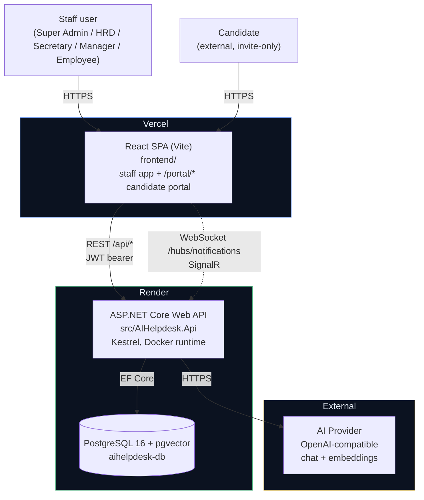
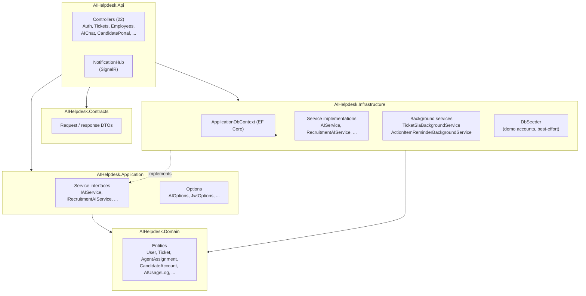
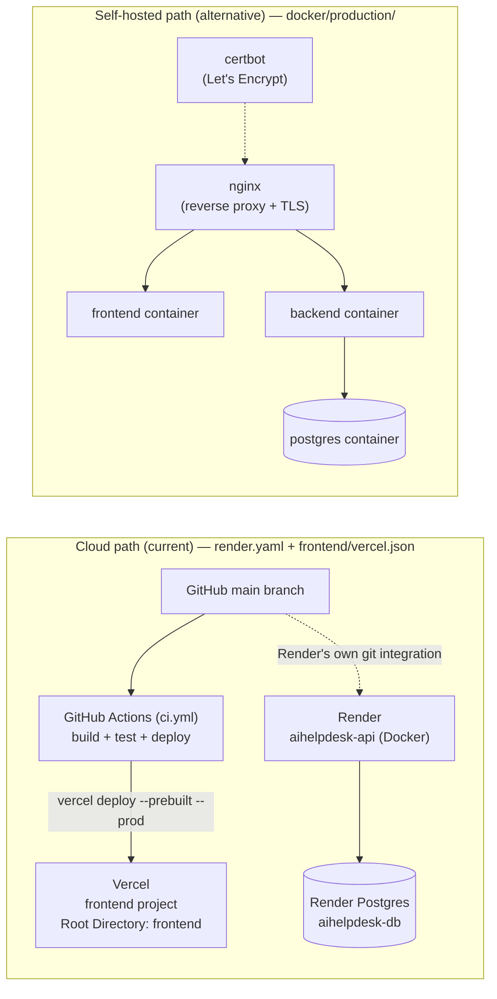
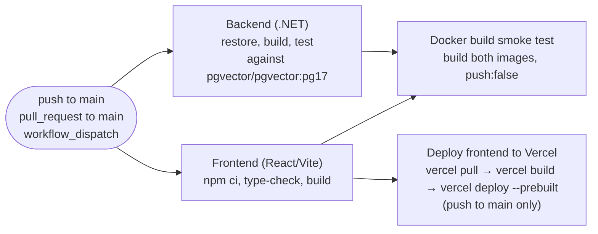
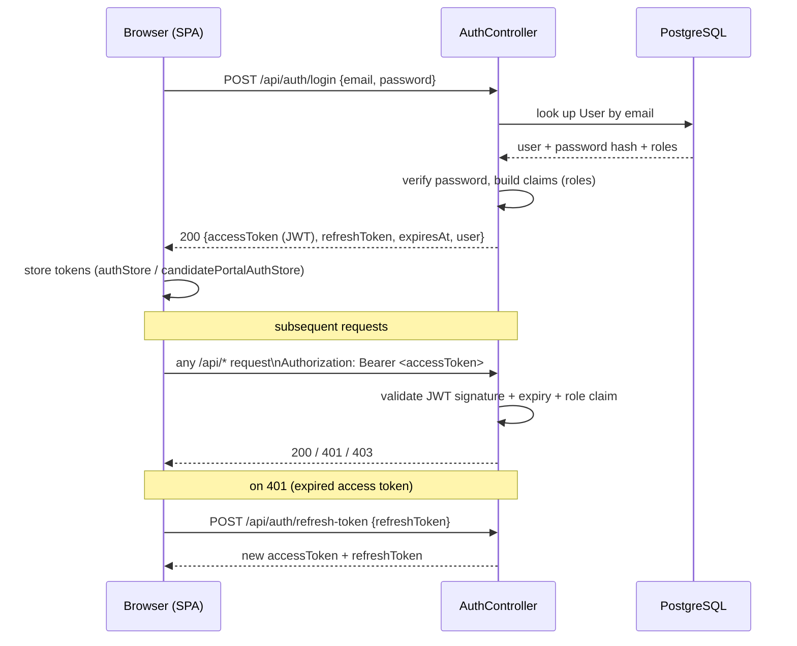
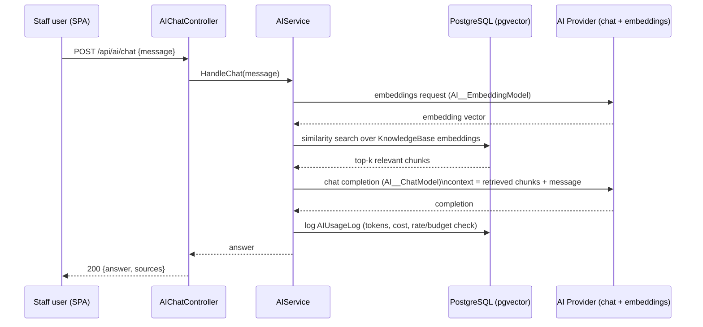
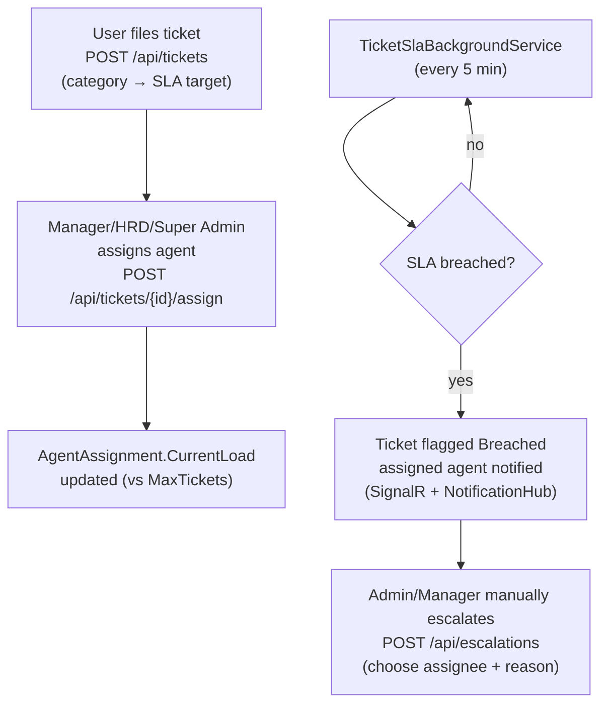

# Architecture Design

## AI Helpdesk — Digital Secretary & HR Assistant

| | |
|---|---|
| **Scope** | Technical/system architecture — components, layers, deployment topology, and key runtime flows. For functional behavior see [`FSD.md`](FSD.md); for environment variables and deploy steps see [`deployment-runbook.md`](deployment-runbook.md). |
| **Reflects** | The system as actually deployed: React SPA on Vercel, ASP.NET Core API on Render, PostgreSQL (pgvector) on Render. |

---

## 1. System Context

One React SPA serves both the internal staff app and the external candidate portal (same bundle,
different route prefix and JWT audience). It talks to a single ASP.NET Core Web API, which is the
only component with direct database access.

---

## 2. Backend — Clean Architecture Layers

`src/` is split into five projects with a strict inward dependency rule: `Api` depends on
`Application` and `Infrastructure`; `Infrastructure` implements `Application`'s interfaces;
`Domain` has no dependencies at all.

Notes:
- Controllers depend only on `Application` interfaces, never on `Infrastructure` concrete types —
  `Program.cs` wires the DI container.
- `DbSeeder` runs on every startup but failures are caught and logged, not fatal (see
  `Program.cs` lines ~148–155) — seed data is best-effort demo content, not a boot dependency.
- Two background services run inside the same API process (no separate worker deployment):
  SLA breach checks every 5 minutes, and action-item reminders.

---

## 3. Deployment Topology

Two deployment paths exist in the repo. **Cloud (current, live)** is what's actually running;
**self-hosted Docker** is an alternative path for on-prem/VPS deployment.

CI pipeline detail (`.github/workflows/ci.yml`):

---

## 4. Auth Flow

Two independent JWT audiences share the same `AuthController` shape but issue tokens scoped to
different claim sets: `AIHelpdesk` for the five staff roles, `AIHelpdesk-CandidatePortal` for
candidates. A candidate token cannot satisfy `[Authorize]` on any staff endpoint, and vice versa.

---

## 5. AI Chat & Knowledge Base (RAG)

`pgvector` stores embeddings for knowledge-base documents; chat responses are grounded by
similarity search before calling the chat model.

Rate limiting (`AI__RateLimit__*`) and a daily token budget (`AI__Budget__*`) are enforced in
`AIService` before calling out to the provider — see [`FSD.md §5`](FSD.md) for the exact rules.

---

## 6. Ticketing, Agent Assignment & SLA

There is no dedicated "Agent" login role — Manager, HRD, and Super Admin can all act as ticket
agents. Assignment is always a manual action; only SLA breach detection runs automatically.

---

## 7. Role-Based Access Summary

| Area | Super Admin | HRD | Secretary | Manager | Employee |
|---|:---:|:---:|:---:|:---:|:---:|
| Users / Roles / Departments | ✅ | ✅ | – | – | – |
| Employees / Leave admin | ✅ | ✅ | – | view own | view own |
| Meetings / Documents / Action Items | ✅ | ✅ | ✅ | ✅ | limited |
| Ticket Categories | ✅ | ✅ | – | – | – |
| Agent Workload (`/tickets/agents`) | ✅ | ✅ | – | – | – |
| Escalations | ✅ | – | – | ✅ | – |
| Recruitment / Candidates | ✅ | ✅ | – | – | – |
| AI Chat / Knowledge Base | ✅ | ✅ | ✅ | ✅ | ✅ |
| Candidate Portal | *(external, separate JWT audience — not a staff role)* | | | | |

Source of truth: nav/route guards in `frontend/src/components/layout/AppLayout.tsx` and
`frontend/src/App.tsx`, mirrored by `[Authorize(Roles = ...)]` on each controller action.

---

## 8. Key Design Decisions

- **No microservices** — one API process handles HTTP, SignalR, and background jobs. Justified by
  scale (internal tool, Render free-tier hosting); revisit if traffic or team size grows.
- **pgvector over a dedicated vector DB** — keeps infra to a single Postgres instance; acceptable
  at current knowledge-base size.
- **Manual ticket assignment, no auto-routing** — explicit product decision (see `FSD.md`
  "Out of Scope"), not a missing feature.
- **Vercel's own Git integration is disconnected** (`vercel git disconnect`, 2026-08-12) —
  GitHub Actions' `deploy-vercel` job is the sole deploy path, avoiding a duplicate-deploy race.
  See [`deployment-runbook.md`](deployment-runbook.md) for current status of that job.
